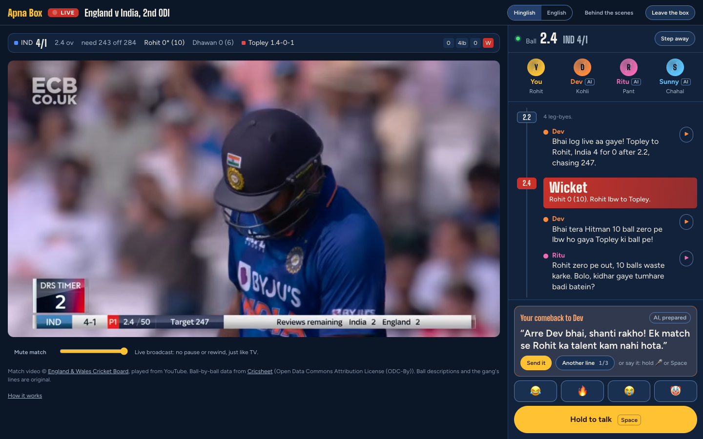
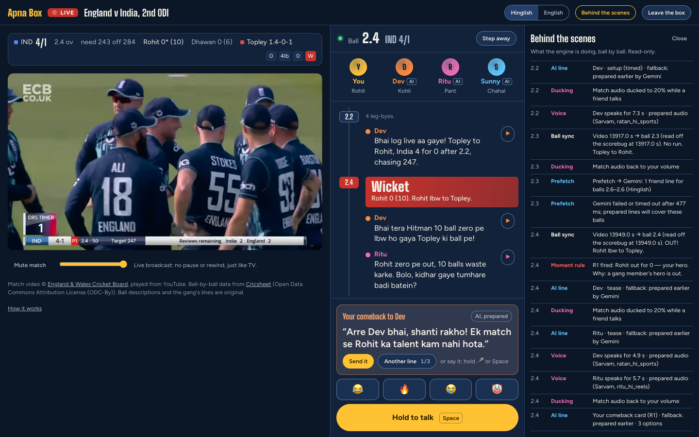
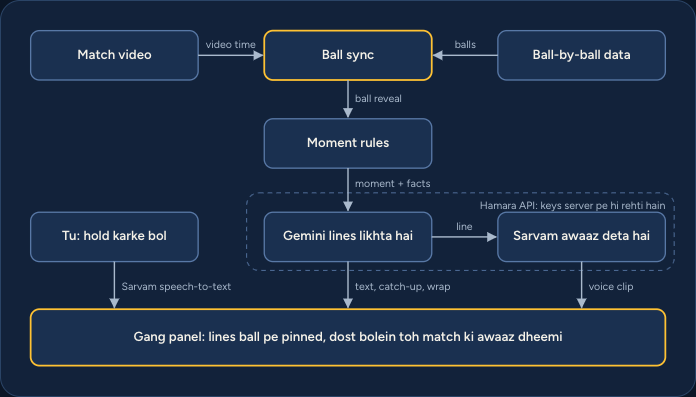

# Apna Commentary Box

**Watch with your gang, even when you're apart.**

Watching a big match apart from your friends loses the best part: teasing the friend whose hero just got out, the
shared groan when a wicket falls, the "told you so". Today that means leaving the stream for a group chat, and by the
time you've typed, the moment has gone.

Apna Commentary Box puts your gang's voices **beside the match**, like your own commentary team. Every voice note is
pinned to a ball, so nobody hears about a wicket before their own screen shows it. AI spots the moments that matter
to *your* gang and hands you the perfect comeback.

**▶ Try it: [ourcommentarybox.vercel.app](https://ourcommentarybox.vercel.app/)**. Sound on; it takes about 3 minutes.



---

## Contents

- [What happens when you join](#what-happens-when-you-join)
- [Features](#features)
- [How it works](#how-it-works)
- [Chrome extension](#chrome-extension)
- [Run it locally](#run-it-locally)
- [Configuration](#configuration)
- [Testing](#testing)
- [Project structure](#project-structure)
- [Credits](#credits)

## What happens when you join

The demo puts you in a real match, England v India, 2nd ODI at Lord's (2022), as a **live broadcast**. You join
India's chase in progress, with three AI friends: Dev, Ritu and Sunny.

| When | What you'll see and hear |
|---|---|
| 0:00 | You join live at 2.2 overs, India 4/0 chasing 247. Dev sets the scene. |
| ~0:38 | **Wicket:** Rohit lbw to Topley. Rohit is your hero, so the gang teases you in Hinglish, and the match audio dips while they talk. |
| ~0:55 | The AI hands you a comeback. Tap it, or hold 🎤 / Space and say it; a friend answers back. |
| ~2:00 | The gang suggests stepping away for 20 seconds. The match keeps going without you. |
| on return | A catch-up of what you missed, plus the voice notes the gang left while you were gone. |
| any time | **Leave the box** opens your wrap: top moments, the best line, and an audio reel. |

The match runs on to the last ball if you stay. It is live, so there is no pause or rewind, just like TV.

## Features

- **Ball-synced voice commentary.** Lines are pinned to the ball they were said on and play only when your video
  reaches it. No spoilers, even when friends are on different stream delays.
- **AI that knows your gang.** Rules spot what matters to each friend: their hero out, their villain gone, a big over,
  a milestone. Gemini writes what each friend would say, in their own personality.
- **Hinglish by default.** Natural Hindi-English banter, voiced by Sarvam AI in Indian voices. You can switch to
  English in one tap. Talk back in Hindi, English or a mix; your words show up in Roman script.
- **Your comeback, ready.** When the gang teases you, the AI suggests a line you can send with one tap or say out loud.
- **Step away, catch up.** Switch tabs or step away; the match carries on. When you're back, the gang catches you up in
  a sentence and plays what you missed.
- **Match audio ducking.** The broadcast dips while a friend speaks, then comes back.
- **The wrap.** At the end, or whenever you leave, you get the night's headline, top moments, the best line and an
  audio reel. It is saved to your memories in this browser.
- **Behind the scenes.** An optional live log of what the engine is doing, ball by ball: video time → ball, which rule
  fired and why, whether a line was prefetched, live or a fallback, which voice spoke, when the audio was ducked.
- **Safe by design.** Banter stays wholesome. A filter in both Roman and Devanagari script blocks religion, caste,
  region, body-shaming, profanity and betting talk. API keys never leave the server.
- **Never silent, never broken.** If live AI is slow or down, prepared lines and voices take over seamlessly. If the
  video can't play, a scoreboard replay takes over at the same ball.

<p align="center"></p>

## How it works



1. **Ball sync.** Every ball in the match has a time in the video. Some were tagged by hand, some read off the
   on-screen scoreboard, and the rest filled in between. The panel reads the player's time four times a second. When
   the time passes a ball, that ball is revealed, and only then do the lines pinned to it play.
2. **Moment rules** (deterministic) decide *when* something matters to your gang.
3. **Gemini** writes *what* each friend says. The look-ahead asks for lines minutes before the ball arrives, so they're
   ready on time. Each line comes back twice: a Roman-script version to show and a Devanagari version to speak.
4. **Sarvam AI** voices the friends (Bulbul text-to-speech) and transcribes you (Saaras speech-to-text).
5. **The gang panel** shows it all beside the video. It never covers the match.

A longer, two-minute explanation lives in the app at
[/how-it-works](https://ourcommentarybox.vercel.app/how-it-works).

**What's real and what's simulated:** the match video (the ECB's own upload, embedded from YouTube), the ball-by-ball
data, the AI and the voices are all real. Dev, Ritu and Sunny are AI friends standing in for your gang, and the "live"
broadcast is a recording played on a live clock.

## Chrome extension

The same gang panel also runs in Chrome's **side panel**, next to the match playing in your own YouTube tab. There,
YouTube's normal controls apply and the gang follows your video. It asks for one permission (`sidePanel`) and holds no
API keys.

```bash
npm run build:extension      # → extension/dist, then load it at chrome://extensions → "Load unpacked"
```

The full guide (loading, pointing it at a deployed API, and a 2-minute demo) is in
[extension/README.md](extension/README.md).

## Run it locally

You need Node.js 20+ and two API keys: [Google Gemini](https://aistudio.google.com/) and
[Sarvam AI](https://dashboard.sarvam.ai/).

```bash
git clone https://github.com/NileshChakrabarty/ourcommentarybox.git
cd ourcommentarybox
npm install
cp .env.example .env     # add GEMINI_API_KEY and SARVAM_API_KEY (.env is git-ignored)
npm run smoke            # optional: checks both keys work (prints PASS/FAIL, never the keys)
npm run dev              # → http://localhost:5173
```

Already have a `.env`? Skip the `cp` step, or it will overwrite your keys.

Handy while developing:
- `http://localhost:5173/?speed=6` runs the live clock 6× faster.
- `?source=scoreboard` forces the scoreboard replay instead of YouTube.
- `http://localhost:5173/dev/tag` is the ball-tagging tool. It is dev only and never shipped.

## Configuration

Set these in `.env` locally, or in your hosting provider's environment variables.

| Variable | Required | What it does |
|---|---|---|
| `GEMINI_API_KEY` | yes | Writes the gang's lines, catch-ups and wraps |
| `SARVAM_API_KEY` | yes | Voices the friends and transcribes your voice notes |
| `ALLOWED_ORIGIN` | in production | Comma-separated origins allowed to call the API, e.g. `https://your-app.vercel.app,chrome-extension://aoiegnfccbedbnhagelbfojlbapjlfid` |
| `RATE_LIMIT_PER_MIN` | no | Per-IP request limit for the AI endpoints (default 60) |
| `GEMINI_MODEL_*`, `SARVAM_*_MODEL` | no | Override the models; defaults are in `.env.example` |

**Deploying to Vercel:**
1. Import the repo.
2. Set the variables above.
3. Deploy. `vercel.json` builds the app and serves the `api/` functions.

## Testing

```bash
npm test                          # unit + API tests (Vitest)
npm run test:e2e                  # browser journeys (Playwright) + WCAG 2.1 AA scan
E2E_NO_LIVE=1 npm run test:e2e    # the same, without spending AI credits
npm run build                     # typecheck + build; fails if any key leaks into the bundle
```

What the tests cover:
- the live clock (no pause or seek, keeps running while hidden);
- the first-minutes journey timing;
- pacing across the whole match;
- ball sync and the no-spoiler rule;
- Hinglish and English line validation;
- the safety filters;
- catch-up after a hidden tab;
- the wrap;
- the extension's video sync;
- CORS.

## Project structure

```
src/
  core/          pure logic, no React or DOM: timeline, ball tracker, moment rules, the gang "director", pacing
  panel/         the gang panel: host-agnostic, the same code in the web app and the extension
  hosts/web/     the web app: join flow, the live broadcast, the room layout
  hosts/extension/  the Chrome side-panel app
  services/      engine, AI client, audio, storage, match sources (YouTube, scoreboard, <video>)
  stage/         the broadcast area: player, live scoreboard strip, volume
  how/           the /how-it-works page
api/             serverless AI proxy: react, lines, reply, speak, transcribe, catchup, wrap
extension/       Chrome extension (Manifest V3)
data/            match source data and build scripts (npm run data / timeline / precompute)
docs/decisions/  architecture decision records: why things are the way they are
```

Data tooling:
- `npm run data` rebuilds the match from Cricsheet.
- `npm run timeline` rebuilds the ball ↔ video-time map.
- `npm run precompute` regenerates the prepared fallback lines and voices in both languages; review them in
  [docs/precomputed-review.md](docs/precomputed-review.md).

## Credits

- **Match video:** © England & Wales Cricket Board, embedded from their official YouTube upload. It is never
  downloaded or re-hosted.
- **Ball-by-ball data:** [Cricsheet](https://cricsheet.org/), under the Open Data Commons Attribution License
  (ODC-By). Ball descriptions and every line the gang says are original.
- **AI:** [Google Gemini](https://ai.google.dev/) for text, and [Sarvam AI](https://www.sarvam.ai/) for Indian-language
  voices and speech recognition.
