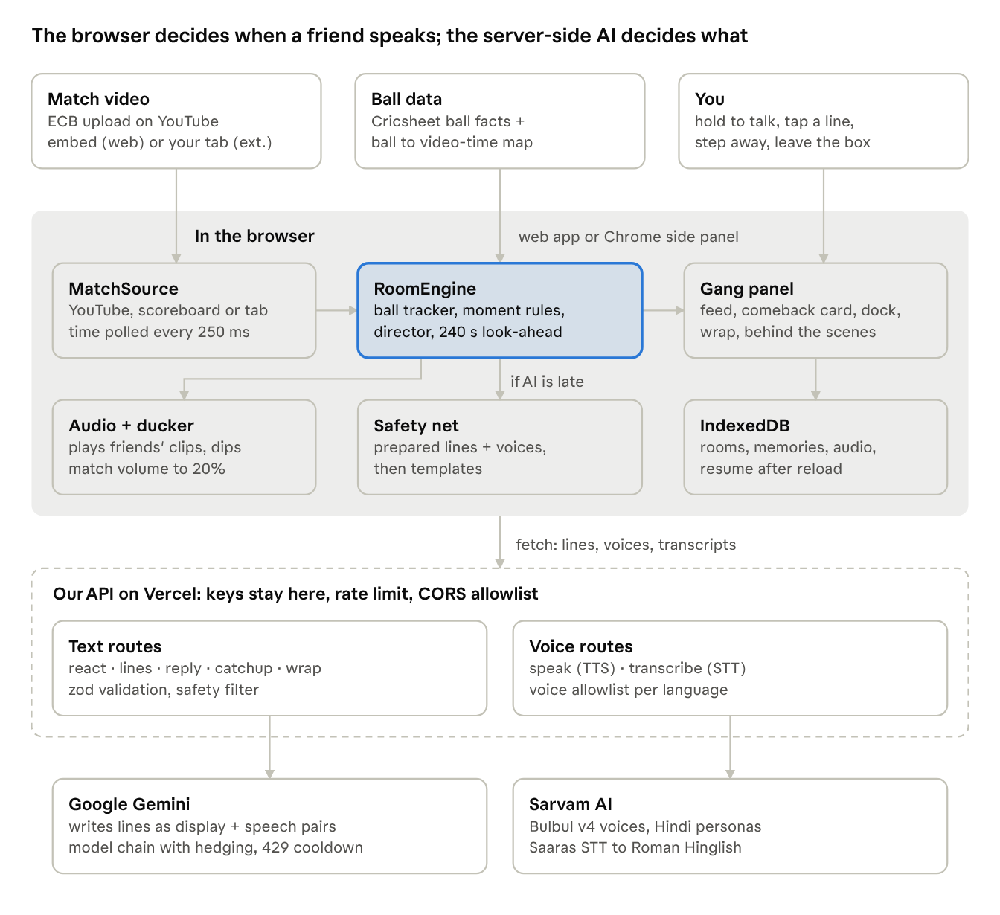

# OurCommentaryBox: Complete Project Documentation

As of 16 November 2026

## Executive summary

Apna Commentary Box (repo name: ourcommentarybox) is a watch-together cricket app: your gang's voice commentary plays beside the match, pinned ball by ball, so nobody hears about a wicket before their own screen shows it. It is live at [ourcommentarybox.vercel.app](https://ourcommentarybox.vercel.app/) and ships as both a web app and a Chrome side-panel extension. The current release is v1.3, built over 14–16 November 2026 in 19 commits.

The demo drops you into a real match, England v India, 2nd ODI at Lord's (2022), played as a simulated live broadcast. You join India's chase at 2.2 overs with three AI friends, Dev, Ritu and Sunny, who banter in Hinglish, tease you when your hero gets out, and hand you a comeback you can tap or say aloud. The whole guided experience takes about three minutes.

| Aspect | What it is |
| --- | --- |
| Product | Ball-synced group voice commentary beside a live cricket match |
| Audience | Indian cricket fans who watch big matches apart from their friends |
| Hosts | Web app (Vite + React SPA) and Chrome MV3 side panel, sharing one panel codebase |
| AI | Google Gemini writes lines, catch-ups and wraps; Sarvam AI voices friends (Bulbul TTS) and transcribes the user (Saaras STT) |
| Backend | Seven Vercel serverless functions acting as a keyed AI proxy |
| Match source | ECB's official YouTube upload (embedded, never re-hosted) + Cricsheet ball-by-ball data |
| Fallbacks | Precomputed lines and voices if AI is slow; scoreboard replay if the video fails |
| Quality gates | Vitest unit/API tests, Playwright journeys, axe WCAG 2.1 AA scan, bundle key-leak check |

What is real and what is simulated: the video, the ball data, the AI and the voices are real. The friends are AI stand-ins for your own gang, and the "live" broadcast is a recording played on a live clock.

## The idea: problem, origin and vision

The project began as a submission for the Dream11 Forward Deployed Engineer Intern assignment: "Build one AI-powered artifact that solves a real problem fans face during a live sports match." The rule was that the idea must be the owner's own; AI could be used to build it. Deliverables were a working link plus a note of at most 200 words, judged on hypothesis, conceptualisation, whether it works as claimed, and design during a live match.

### The problem

The owner's own experience: the moment you most miss your friends is when *their* favourite player fails or gets out, because that is when you want to tease them. The friends are watching too, just somewhere else. Three frictions get in the way:

1. **F1, leaving the screen.** You have to switch from the match to another app.
2. **F2, timing.** By the time you have typed, the moment (or the next ball) has passed.
3. **F3, wit on demand.** Typing a good joke on the spot is hard.

The desired feeling is "wholesome" and "we had shared the experience". The owner's reframing gave the product its name: "I want us to do our version of the commentary of the match." The gang becomes the commentary box.

A secondary problem, the casual fan who doesn't know a new player's story, is served only indirectly: the AI weaves player stories into the teases, so context arrives inside the banter.

### Why existing tools fall short

| Option | Where it breaks |
| --- | --- |
| WhatsApp group | Separate app; matches buried in one endless thread; spoilers, because friends' streams run at different delays |
| Discord | Separate app, setup-heavy; live voice cannot be delayed per listener |
| Streaming apps' live reactions | Shared with millions of strangers, not your friends |
| Video-call watch party | Bandwidth, screen-share copyright issues; immersion the owner explicitly did not want |

### Hypothesis

> If friends watching apart could banter in sync with the match, without leaving the stream or typing, they would feel like they watched together, and come back to watch the next match together too.

### Differentiators

- **Ball-pinned messages.** Every clip is anchored to a ball and plays only when *your* stream reaches it.
- **Gang-aware AI.** It knows a wicket matters because that player is a particular friend's hero.
- **Memory per match.** Each match is a room that becomes a keepsake, not an endless scroll.
- **Zero switching.** It lives beside the match.
- **Dream11 fit.** Dream11 doesn't stream matches, so its users already watch elsewhere; private contests already form friend groups that cannot watch together. (Marked in the spec as an assumption to verify.)

### How the concept evolved

The spec's decision history records the path from conversation to scope:

1. Owner proposed two problems (missing friends; casual fans lacking player context) and chose the first.
2. Owner defined the moment, the ritual, and frictions F1–F3, and liked three AI pieces: moment spotting (A), tease prompts (B) and catch-up/wrap (C).
3. Ideas borrowed from movie streaming were sorted: "while you were away" and "come back" adopted, "players as characters" folded into B, "tournament as series" dropped, spoiler-protection mode excluded.
4. Each match became a session (a Match Room) preserved as a memory; Gang Calls (one-tap predictions, bragging rights only) were added.
5. Owner clarified the product is a layer that sits beside any streaming app, not a streaming app.
6. Mobile was ruled out for evaluability; desktop browser chosen, with a demo link first and a Chrome extension only after the link was done.
7. Voice-first was chosen: walkie-talkie clips pinned to the ball, with ducking, a queue, text fallback and AI transcription.
8. Providers were fixed: Google Gemini for text, Sarvam AI for Indian-language speech. Anthropic models were not used at runtime; Claude Code helped design and build.

### Long-term vision

A browser extension over any streaming site; later an Android overlay and a lighter iOS version (Dynamic Island, notifications); automatic sync by audio fingerprinting; real multiplayer rooms for actual friend groups, possibly seeded from Dream11 private-contest groups.

### Proposed success metrics

These cannot be measured in a single-user demo; they are for a real rollout.

| Metric | Definition | Signals |
| --- | --- | --- |
| Banter per match | Clips + reactions per participant per match | Friction removed |
| AI tease use | AI prompts used ÷ shown | AI is useful, not noise |
| Back for the moment | Participants returning within N balls of a call-back | Call-back works |
| Next match | Gangs that open a room for their next match | Belonging (retention) |

## Product walkthrough

A reviewer opens one link, presses **Join the box**, and within 40 seconds hears their AI gang react in Hinglish to a real wicket, with no sign-up, install or settings. The journey is engineered so every feature appears in the first three minutes (ADR-0015), then the match runs on to the last ball.

### The demo match

England v India, 2nd ODI, Lord's, 2022 ([Cricsheet 1276908](https://cricsheet.org/)). The viewer joins India's chase of 247 at 2.2 overs (ball 317, video time 13,911 s). The broadcast runs to ball 536, about 2 h 29 min of real time. The video is the ECB's official YouTube upload, embedded and never re-hosted.

### The gang

The gang is created for you: you (backing India, Rohit as your hero) plus three AI friends, each tagged "AI" in the gang row. Dev, Ritu and Sunny each have a team, a hero, a villain, a personality and a distinct Sarvam voice per language (for example Dev uses `ratan_hi_sports`).

### The first minutes

| Time after joining | What happens |
| --- | --- |
| 0:00 | Landing: one line, "Watch with your gang, even when you're apart.", one button, and the AI-friends disclosure |
| 0:03 | Broadcast starts live: ● LIVE badge, scoreboard strip (IND 4/0 · 2.2 ov · need 243 off 286), mute and volume only |
| \~0:07 | Dev's join line, voiced in Hinglish; match audio ducks to 20% |
| 0:38 | Wicket: Rohit lbw to Topley. Red wicket slab; Dev and Ritu tease you |
| \~0:55 | Comeback card: "Your comeback to Dev" with Send it, Another line (up to 3), or say it with 🎤 / Space |
| \~1:20 | Send it, and Dev answers live (Gemini 2.0 s + Sarvam 1.7 s in the recorded walkthrough) |
| 1:23 | Ritu talks over the replays (a timed line; no ball for \~3 minutes) |
| 2:00 | Sunny's nudge: "Step away for 20 s and come back." |
| on return | Catch-up card ("While you were away") plus up to 3 missed voice clips |
| any time | Leave the box opens the wrap |

### Features

- **Ball-synced voice commentary.** Lines are pinned to a ball and play only when your video reaches it.
- **Gang-aware moments.** Deterministic rules (R1–R7) spot what matters to each friend: hero out, villain gone, big over, milestone.
- **Hinglish by default.** Every line comes as Roman Hinglish to display and Devanagari to speak; one tap switches to English, remembered locally.
- **Talk back.** Hold 🎤 or Space to record; Sarvam transcribes Hindi, English or a mix into Roman script, and a friend replies live.
- **Comeback card.** When the gang teases you, AI suggests a line you can send or say.
- **Step away, catch up.** The live clock keeps running while you're away or the tab is hidden. A friend remarks on your absence; a wicket while you're gone triggers a call-back; on return you get a one-sentence catch-up and the missed clips.
- **Match audio ducking.** The broadcast dips while a friend speaks.
- **Live, like TV.** No pause, seek or rewind. The embed has no controls; if autoplay is blocked, the panel shows "Start the broadcast".
- **The wrap.** At match end or on Leave the box: a Gemini headline, top moments (wickets and sixes this viewer saw), the best line, an audio reel of up to four clips, and how long you watched. Saved to a memory shelf in the browser.
- **Gang Calls (optional).** One-tap predictions for bragging rights, off by default, offered every fifth over when switched on behind More.
- **Behind the scenes.** An off-by-default engine log, stamped by over.ball: video time → ball, which rule fired and why, line source and latency, voice, ducking, prefetch.
- **/how-it-works.** A two-minute in-app explainer with an architecture diagram, in Hinglish or English.
- **Chrome extension.** The same panel in Chrome's side panel, following the match in your own YouTube tab.
- **Safe by design.** A filter in Roman and Devanagari script blocks religion, caste, region, body-shaming, profanity and betting talk.
- **Never silent, never broken.** Prepared lines and voices cover slow or failed AI; a scoreboard replay covers a failed video at the same ball.

### Developer switches

- `?speed=6` runs the live clock 6× faster (up to 50×; tests only, not in the UI).
- `?source=scoreboard` forces the scoreboard replay instead of YouTube.
- `/dev/tag` is the ball-tagging tool, dev only and checked out of the production bundle.

## System architecture

The system is a static single-page app plus a thin serverless AI proxy, with no database or real-time server (ADR-0001). Deterministic code in the browser decides *when* something matters and *when* a line plays; Gemini and Sarvam, reached only through the proxy, decide *what* is said and how it sounds.

The engine reads the match time from whichever source is active, reveals balls as the video reaches them, and asks the API for lines minutes ahead; if the AI is late, the prepared safety net speaks instead.

### Layers

| Layer | Responsibility | Where |
| --- | --- | --- |
| Match source | One `MatchSource` interface over the YouTube embed, the scoreboard fallback, or the extension's `<video>` reports | `src/services/source/` |
| Core logic | Pure TypeScript, no React or DOM: timeline, ball tracker, moment rules, friend director, pacing plan, Gang Calls, wrap stats | `src/core/` |
| Engine | `RoomEngine` ties source time to events, prefetches AI, plays audio, handles away, catch-up and wrap | `src/services/engine.ts` |
| State | One Zustand store for the room | `src/store/room.ts` |
| Panel | Host-agnostic UI: feed, dock, talk button, wrap, shelf, behind-the-scenes log | `src/panel/` |
| Hosts | Web app (start screen, live stage, scoreboard strip) and Chrome side panel | `src/hosts/`, `src/stage/` |
| API proxy | Seven Vercel functions; keys, validation, safety, rate limiting, CORS | `api/` |
| Persistence | IndexedDB (rooms, memories, audio blobs), localStorage (language, Gang Calls toggle) | `src/services/storage/db.ts` |

### Tech stack

| Area | Choice |
| --- | --- |
| Language | TypeScript 5.6 |
| UI | React 18.3, plain CSS with design tokens |
| State | Zustand 4.5 |
| Validation | Zod 3.23 (shared request schemas) |
| Build | Vite 5.4 (separate config for the extension) |
| Serverless | Vercel Functions, Web `Request`/`Response` signature, 15 s max duration |
| Text AI | Gemini via REST `fetch` (no SDK), chain: 3.5-flash → 3.6-flash → 3.5-flash-lite → 3.1-flash-lite → flash-lite-latest |
| Voice AI | Sarvam `bulbul:v4-flash` (TTS), `saaras:v3` translit / `saaras:v4` (STT) |
| Video | YouTube IFrame Player API, loaded at runtime |
| Tests | Vitest 2.1 + jsdom + Testing Library; Playwright 1.49 + axe-core |

Only four runtime dependencies ship: react, react-dom, zustand and zod.

### What happens on a wicket

1. Up to 240 s of video before the ball, the engine's look-ahead sends `/api/react` the beats it plans for that window (which friend speaks on which ball, and why).
2. The proxy looks up personas server-side, asks Gemini for `{display, speech}` pairs, runs every line through the safety filter, and returns them.
3. The engine requests voices from `/api/speak`, which calls Sarvam with an allowlisted persona for the language, and caches the mp3.
4. Polling every 250 ms, the `BallTracker` sees the video pass the wicket's anchor time and reveals ball 2.4.
5. Moment rule R1 fires (your hero is out); the wicket slab appears and Dev's and Ritu's clips play, while the ducker dips the match to 20%.
6. About 14 s later, after the teases finish, the comeback card appears with lines that were prefetched in the same batch.

## Implementation deep dive

The codebase is about 6,900 lines of TypeScript across `src/` and `api/`, with the logic that matters most kept pure and unit-tested in `src/core/`. Each subsection below covers one mechanism: what it does, how, and where.

### 1. Match data pipeline

- **Ball facts.** `npm run data` runs `data/scripts/convert-match.ts`, turning Cricsheet match 1276908 into `public/data/match.json`: runs, extras, wickets, batter and bowler per ball. Ball text ("SIX! X hits Y for six.") is original and generated from facts only; no shot direction or fielding detail is invented.
- **Ball ↔ video time.** You cannot watch a video in CI, but you can read its scorebug. The build sampled the embedded player's on-screen scorebug in automated Chrome, resolving each reading (overs + score) to a Cricsheet delivery: 88 readings resolved, 0 unresolved, which also cross-checks the data. Evidence lives in `scorebug-observations.json`; no frames were kept.
- **Timeline build.** `npm run timeline` merges three sources in priority order: manual tags from `/dev/tag` (always win), scorebug anchors, then linear interpolation by delivery index for every other ball (`src/core/timeline.ts`). Outside the anchors it extrapolates at 40 s per ball, and it enforces monotonic time so a bad tag can't make time run backwards.
- **Live window.** `public/data/live.json` sets the join point (ball 317, 6 s lead), the end (ball 536), the 180 s guarantee window, the 14 s comeback delay, the 120 s nudge and all pacing constants.

### 2. Ball sync and the no-spoiler rule

`Timeline.ballAt(t)` binary-searches the current ball for a video time. The pure `BallTracker` (`src/core/tracker.ts`) turns successive times into events:

- `reveal(seq)` for each new ball during normal play; only then do lines pinned to that ball play.
- `skip(from, to)` for a forward jump of more than 2 balls; skipped items go to the catch-up, never a burst of clips.
- `rewind(to)` when the playhead moves back; position only.
- Nothing while paused, buffering or in an ad.

A spoiler high-water mark, `maxRevealed`, guarantees nothing is ever re-delivered. `RoomEngine` polls the active source every 250 ms (ADR-0008). Because a real video cannot wait for Gemini, there are no clock holds: the engine relies on look-ahead instead.

### 3. Moment rules (R1–R7)

Deterministic, pure functions in `src/core/moments/rules.ts` decide *when* something matters to the gang.

| Rule | Fires when | Severity |
| --- | --- | --- |
| R1 | A gang member's hero is out | 3 |
| R2 | A gang member's villain is out | 2 |
| R3 | A hero bowler concedes 15+ in an over | 2 |
| R4 | A hero bowler is hit for six | 1 |
| R5 | A hero reaches 50 or 100, or a hero bowler takes a 3rd wicket | 2 |
| R6 | Chase finish near: need ≤ 24 with ≤ 30 balls left (adapted, ADR-0003), fires once | 3 |
| R7 | Final ball of the match | 3 |

The user gets at most one card per over (except R1/R2), one per ball at the highest severity. A card's kind follows from who the victim is: a **tease** when a friend is the victim, a **comeback** when you are, a **brag** when your call or player came good.

### 4. Friends director and pacing

`src/core/friends/director.ts` decides *which* friend speaks, *when* and with what intent (setup, chatter, lull, tease, gloat, nudge\_away, callback, reply and more). It is pure and deterministic, and each beat carries only facts up to its own ball. Pacing from ADR-0014:

- Wickets, fours and sixes always get a voice; a wicket or six gets two friends; loyalty moments come first.
- Ordinary balls speak only after a quiet spell: 110 s for a single, 165 s for a dot ball, 45 s during the first 7 minutes.
- Never two lines within 12 s unless it is a big ball, and never more than two voices on one ball.
- Breaks of 70 s+ get a timed line 45 s in; breaks of 140 s+ also get one 35 s before play restarts, naming the incoming batter.
- Result over the full chase: 87 lines, one every \~2 minutes, longest silence 3.4 minutes, 95%+ of wickets and boundaries voiced, at most 30% of dot balls.

### 5. AI line generation

- **Look-ahead.** The engine looks 240 s of video ahead and batches every friend line and card line in that window into one `/api/react` call. A window is urgent when a beat is under 75 s away; since the v1.3 walkthrough, urgent windows go out as at most 3 lines with the card in its own parallel request, which brought the first minute from fallback to live.
- **Fallback ladder.** At reveal, a line still in flight gets at most 1.2 s. Then it falls to the precomputed line, then a template. The UI and the log tag each line live, prepared or fallback.
- **Gemini client** (`api/_lib/gemini.ts`). Plain REST `fetch` with JSON output, thinking disabled on non-lite models, a hard timeout, and a model chain. A 429 or 503 cools that model for 60 s. If a model hasn't answered after the hedge delay (2.5 s by default, 6 s for prefetch), the next one starts too; the first valid answer wins, up to 3 attempts.
- **Prompts** (`api/_lib/prompts.ts`). User text is always passed as JSON data, never as instructions. Rules: wholesome cricket teasing; no religion, caste, region, gender, body, family, profanity or betting; only facts given; no spoilers; no invented shot descriptions.
- **Display/speech pairs** (ADR-0013). Every spoken line is `{display, speech}`: Roman Hinglish to show, the same line with Hindi words in Devanagari to voice, because romanised Hindi degrades TTS quality. For English, speech equals display.
- **Personas are server-side.** `src/content/gang.ts` is shared by client and server; the server looks personas up by friend id so the client cannot inject persona text.

### 6. Voices, transcription and ducking

| Friend | Persona | English voice | Hinglish voice |
| --- | --- | --- | --- |
| Dev | Loud optimist, Kohli worshipper, calls everyone "bhai" | `dev_en_conversational` | `ratan_hi_sports` |
| Ritu | Pant superfan, deadpan, keeps receipts | `ritu_en_reels` | `ritu_hi_reels` |
| Sunny | Pessimist, Chahal loyalist, "told you so" | `sunny_en_social` | `sunny_hi_reels` |

- **TTS.** `/api/speak` calls Sarvam `bulbul:v4-flash` with `language_code` `hi-IN` or `en-IN`, mp3 at 24 kHz (\~40 KB a line), and accepts only the persona allowed for that language.
- **STT.** `/api/transcribe` uses `saaras:v3` in `translit` mode for Hinglish (Roman output for Hindi, English or code-mixed speech) and `saaras:v4` for English. Audio is not stored.
- **Ducking.** Cross-origin iframe audio can't go through Web Audio, so the `Ducker` steps `player.setVolume()` down to 20 over 200 ms (8 steps) while a clip plays, then restores it. If the user moves the slider mid-clip, their value wins.

### 7. The simulated live broadcast

`LiveBroadcast` wraps the player (ADR-0014). Live time is `joinT + (now − joinedAt) × rate`, on the wall clock. It ignores pause and seek, resumes a paused player, pulls it back if it drifts more than 4 s, and keeps running while the tab is hidden. A reload rejoins the same room at the original `joinedAt`. The embed runs with `controls=0`, `disablekb=1`, `rel=0`, `fs=0`; mute and volume are our own controls beside it.

### 8. Match sources and fallback

`MatchSource` (`getCurrentTime`, `play`, `pause`, `seekTo`, `setVolume`, `getVolume`, `getState`, `onStateChange`) is the only way the app touches the match.

- `YouTubeSource` maps player states; buffering, unstarted, cued and ads count as paused.
- `ScoreboardSource` runs a stylised scoreboard replay on the same timeline, with a synthesized crowd.
- `VideoElementSource` (extension) turns content-script reports into a source.
- Fallback to the scoreboard triggers if the IFrame API doesn't load in 10 s, the player isn't ready in 12 s, or any `onError` (2, 100, 101, 150). Error 5 is retried once first. `attach()` swaps sources mid-room while keeping the tracker, so nothing is re-delivered.

### 9. Content safety

`api/_lib/safety.ts` drops any line that fails a check; the client then falls back to prepared or template lines.

- Blocklists in Roman script and Devanagari: religion, caste, region, gender, body, family, profanity, betting/money, violence.
- Devanagari words are bounded by "not a Devanagari letter" because `\b` doesn't work there, so “साला” is blocked but “मसाला” is not.
- Word and length caps (18 words for friend lines, 15 for card lines).
- Script checks: Hinglish display must have no Devanagari; Hinglish speech must have some.

### 10. API routes

All routes share one `handler()` wrapper (`api/_lib/http.ts`): method check, origin check, per-IP sliding-window rate limit, body-size limit, Zod validation, uniform error codes, and a latency log that never includes user content.

| Route | Does | Upstream |
| --- | --- | --- |
| `/api/react` | Friend lines + card options for a look-ahead window | Gemini |
| `/api/lines` | Tease, comeback or brag options for your card | Gemini |
| `/api/reply` | A friend replies live to what you said | Gemini |
| `/api/catchup` | "While you were away" summary | Gemini |
| `/api/wrap` | Wrap headline, captions and reel picks (ids validated) | Gemini |
| `/api/speak` | Friend voice, returns `audio/mpeg` + `x-voice-model` | Sarvam Bulbul |
| `/api/transcribe` | Your clip to text | Sarvam Saaras |

### 11. Persistence

IndexedDB holds the live room snapshot (join time, feed, calls), audio blobs and the memory shelf. It keeps its original name `fun-banter` so saved memories survived both renames (ADR-0010, ADR-0012). `localStorage` holds the language (`acb-lang`) and the Gang Calls preference.

### 12. Chrome extension

Manifest V3, built by `npm run build:extension` into `extension/dist` (ADR-0017).

- **Side panel** (`sidepanel.html`) renders the same `Panel`, `WrapScreen`, `Shelf` and `XrayLog` as the web app.
- **Content script** (\~40 lines of plain JS) runs on `youtube.com/watch*` but acts only on `v=UnRMj4ZC12o`. Every 250 ms it posts `{t, paused, rate, ad, volume, muted}` over a `chrome.runtime` port. The only command back is a clamped volume, for ducking.
- **`VideoElementSource`** extrapolates between reports, goes stale after 2.5 s, treats ads as pauses and ignores other videos. Play, pause and seek do nothing; the viewer owns the player.
- **Permissions:** `sidePanel` only; no host permissions. A public key in the manifest pins the ID to `aoiegnfccbedbnhagelbfojlbapjlfid`.
- **No keys.** AI calls go to `ACB_API_BASE`; match data and prepared voices are bundled so the safety net works offline from the API.

### 13. UI and design system

The "commentary box" redesign (ADR-0006) replaced a chat-app shape with a ball rail: voices hang off the ball they were said on.

- **Tokens** in `src/styles/tokens.css`: ink and chalk, one action colour (marigold), red for wickets only, gang colours, a 7-step type scale, 4-pt spacing, 3 radii plus pill, 4 durations and 2 easings. No colour literals outside the tokens.
- **Zero typing during play.** Hold Space or the mic, tap a reaction, or send the offered line.
- **One prompt at a time** in the dock: catch-up, then line card, then Gang Call.
- **The wicket slab** is the one bold element; wickets also flash the panel edge and vibrate where supported.
- **Avatars** are cricket balls in each friend's colour, with a seam. The start screen puts the gang on the sill of a marigold box, next to your empty seat (ADR-0011).
- **Accessibility.** WCAG 2.1 AA via an axe scan, contrast-checked borders (≥ 3:1) and text, reduced-motion support, responsive down to 390 px.

### 14. Behind the scenes and /how-it-works

The engine always writes an event log (capped at 400 entries), stamped by over.ball: ball sync with the anchor source, rule firings with reasons, line source and latency, each Gemini batch with model and timing, voice model and persona, ducking, broadcast corrections, and away events. It never shows keys, prompts, request bodies or the viewer's words; a test asserts no entry looks like a key. `/how-it-works` is a lazy-loaded page with an inline SVG architecture diagram and four short sections, in Hinglish or English (ADR-0016).

## Key design decisions

Seventeen architecture decision records in `docs/decisions/` explain why the project is shaped the way it is. Three themes run through them: the link must always work, a real video cannot wait for AI, and the reviewer must feel the product in three minutes.

| ADR | Decision | Why | Status |
| --- | --- | --- | --- |
| 0001 | Static Vite/React SPA + thin Vercel AI proxy; no database; Gemini over raw `fetch` | "The link must always work"; full control of timeouts and fallback; keys only on the server | Accepted |
| 0002 | Sarvam formats verified: `language_code`, `bulbul:v4-flash`, mp3 24 kHz, `saaras` STT | The spec's field names were outdated; verified with live smoke tests | Accepted |
| 0003 | R6 adapted, scripted nudge, compressed pacing (v1.1 match) | The original close-chase rule never fired in that match | Superseded by 0007/0008/0014 |
| 0004 | Batch lines per look-ahead window; model chain with 60 s cooldown; precomputed safety net | Gemini free tier allowed 5 requests/min per model; a run made \~30 calls | Accepted |
| 0005 | Full-match ECB YouTube embed as the source, scoreboard replay as fallback | Highlights skip balls; a synthetic scoreboard never felt like "beside the match" | Accepted |
| 0006 | "The commentary box" redesign: ball rail, one prompt at a time, one big mic, design tokens | Audit found a chat-app shape and generic look | Accepted |
| 0007 | Chapter-based 5-minute journey with demo time-skip | A real-time video runs \~40 s per ball | Superseded by 0014 |
| 0008 | Engine runs on source time; 240 s AI look-ahead; no clock holds | A video can't pause for Gemini | Accepted (time-skip parts superseded) |
| 0009 | No new runtime dependencies; dev tools never ship; cut typing box and IND v NZ data | Keep the bundle small and "zero typing during play" | Accepted |
| 0010 | Rename to Our Commentary Box; IndexedDB keeps `fun-banter` | Renaming the database would orphan memories | Name superseded by 0012 |
| 0011 | Start screen: the gang sits on the box, your empty seat beside them | Show the idea instead of describing it | Accepted |
| 0012 | Rename to Apna Commentary Box ("apna" = our own) | Owner instruction | Accepted |
| 0013 | Hinglish by default; `{display, speech}` pairs; per-language personas; bilingual blocklist | Romanised Hindi degrades TTS; only `saaras:v3` translit returns Roman script | Accepted |
| 0014 | Recorded match played as a live broadcast to the last ball; wall clock; pacing rules | A live match can't be skipped; step-away only means something if the match carries on | Accepted |
| 0015 | 3-minute evaluator journey: one line, one button, one coach hint, wicket at \~38 s | Reviewers judge in minutes; hide anything not used in the journey | Accepted |
| 0016 | Behind-the-scenes engine log and `/how-it-works` page | Make the system's work visible without exposing keys, prompts or user words | Accepted |
| 0017 | One host-agnostic panel, two hosts (web + Chrome MV3 side panel) | The long-term product is an extension over any stream | Accepted |

### Notable trade-offs

- **Simulated friends, real everything else.** The reviewer has no gang and no live match, so friends and "liveness" are simulated while the video, data, AI and voices are real. The app labels the friends as AI.
- **Choosing the join point instead of skipping.** Joining at 2.2 overs puts a wicket at 38 s without ever breaking the live illusion.
- **Deterministic rules plus generative words.** Rules make timing testable and spoiler-safe; the model only writes words, and each word passes a safety filter.
- **Embed, never re-host.** The match video is the rights-holder's own upload, never downloaded, clipped or overlaid.
- **Billing recommendation.** ADR-0004 advises enabling billing on the Gemini project before review, since several reviewers at once would otherwise mostly hear the safety net.

## Version history

The product went from specification to v1.3 in four days: spec v1.0 on 13 November 2026, a working v1.1 on 14 November, a full v1.2 redesign the same evening, and v1.3 on 16 November. The 19 commits are grouped below, newest first.

| Date | Version | What shipped |
| --- | --- | --- |
| 16 Nov | README | Product-first README with screenshots from the live site |
| 16 Nov | v1.3 docs | Spec 1.3, progress log, real-browser walkthrough record, code- and security-review results |
| 16 Nov | v1.3 fixes | 10 code-review findings fixed (4 with regression tests) |
| 16 Nov | v1.3 | Smaller urgent AI batches so the first minute is live; extension README and verifier; ADR-0017 |
| 16 Nov | v1.3 | Behind-the-scenes log, `/how-it-works`, focusable engine log, ducking E2E assertion; ADR-0016 |
| 16 Nov | v1.3 | Hinglish by default, simulated live broadcast, Chrome extension, 3-minute evaluator journey; ADR-0013–0015 |
| 15 Nov | Rename | Our Commentary Box → **Apna Commentary Box** ("Apna Box"); ADR-0012 |
| 15 Nov | Start screen | "The gang is in the box" start screen; ADR-0011 |
| 15 Nov | Rename | Fun-Banter → Our Commentary Box; ADR-0010 |
| 14 Nov | v1.2 polish | UX copy pass, axe WCAG 2.1 AA test and contrast fix, mobile dock stacking |
| 14 Nov | v1.2 fixes | Code-review fixes: final lines land before the wrap, Gang Calls lock, Space-to-talk focus and more |
| 14 Nov | v1.2 step 8 | E2E on a mocked YouTube player (journey, live AI, embed error, rewind, mic denied, resume, hold-to-talk) |
| 14 Nov | v1.2 steps 6–7 | Precomputed safety net for the new match, voice samples, `/dev/tag`, ADR-0005–0009 |
| 14 Nov | v1.2 steps 4–5 | Engine on `MatchSource` time, 4-minute look-ahead, all-India gang, design tokens, commentary-box UI |
| 14 Nov | v1.2 step 3 | `MatchSource` (YouTube + scoreboard fallback), volume ducker |
| 14 Nov | v1.2 step 2 | Ball ↔ video timeline from scorebug anchors, `BallTracker` with spoiler-safe seek rules |
| 14 Nov | v1.2 step 1 | New match: England v India, 2nd ODI, Lord's 2022 |
| 14 Nov | Audit | v1.1 audit and v1.2 redesign plan with before screenshots |
| 14 Nov | v1.1 | Snapshot: New Zealand v India 5th T20I as a stylised scoreboard replay, English banter, 110 files |

### How each version differed

- **v1.0 (spec only, 13 Nov).** A product specification consolidated from the owner's discovery conversation with Claude, with every decision labelled confirmed, proposed, assumption, unresolved or future scope.
- **v1.1 (14 Nov).** NZ v India T20I replayed as an animated scoreboard, compressed into \~3.6 minutes with clock holds while AI generated; English banter; setup with team, hero and villain dropdowns; text box during play. All 31 tasks in the progress log except deploy and extension were done.
- **v1.2 (14 Nov).** An audit (`docs/review/AUDIT.md`) found five critical issues: no real match, overlays covering the stream, \~30 s of dead air, a typing box during play, and an engine hard-wired to a holdable clock. It also found 13 of 37 Gemini calls failing on the free tier. The redesign switched to the real ECB video, a source-time engine with 4-minute look-ahead, the commentary-box UI, and a chapter journey with a demo time-skip.
- **v1.3 (16 Nov).** The owner's change request made it feel live: no seeking at all, a wall-clock broadcast to the last ball, Hinglish by default, a 3-minute guaranteed journey, the behind-the-scenes log, `/how-it-works`, and the Chrome extension sharing the panel.

## Testing, quality and reviews

v1.3 ships with 110 unit and API tests, 10 Playwright browser journeys plus an axe WCAG 2.1 AA scan, a bundle check that fails the build on any key leak, a real-browser walkthrough, a high-effort code review (10 findings, all fixed) and a security review (no findings at confidence ≥ 8).

### Automated tests

| Suite | Tests | Covers |
| --- | --- | --- |
| `api.test.ts` | 20 | Route validation, CORS allowlist, origin checks, persona allowlists, error codes |
| `sync-plan.test.ts` | 17 | Delivery plan, pacing across the whole match, journey beat timing |
| `engine.test.ts` | 12 | Engine behaviour plus regression tests for review findings |
| `timeline-tracker.test.ts` | 11 | Interpolation, monotonic time, reveal/skip/rewind, spoiler high-water mark |
| `source.test.ts` | 11 | YouTube state mapping, scoreboard fallback, ducker |
| `rules.test.ts` | 9 | Moment rules R1–R7 and card selection |
| `calls-wrap-safety.test.ts` | 9 | Gang Calls, wrap stats, Roman and Devanagari safety filters |
| `live.test.ts` | 9 | Live clock (no pause or seek, runs while hidden), hidden-tab catch-up, Leave the box |
| `data.test.ts` | 6 | Match data against the public scorecard |
| `video-source.test.ts` | 6 | The extension's `VideoElementSource` |
| `journey.spec.ts` (E2E) | 10 | Full journey on a mocked YouTube player: live AI, embed-error fallback, rewind rule, mic denied, resume, hold-to-talk, ducking |
| `a11y.spec.ts` (E2E) | 1 | axe WCAG 2.1 AA scan |

A unit test also enforces the architecture: it fails if anything in `src/panel/` imports from `stage/`, `hosts/` or a concrete player source.

E2E runs in Chromium at 1440×900 with a fake microphone and autoplay allowed. `E2E_NO_LIVE=1` runs the same journeys without spending AI credits.

### Build-time guards

`scripts/check-bundle.mjs` runs after both the web and extension builds and fails if the output contains:

- either API key value or its first 12 characters;
- the names `GEMINI_API_KEY` or `SARVAM_API_KEY`, or the auth headers `api-subscription-key` and `x-goog-api-key`;
- any dev-only tool (`/dev/tag`, the dev probe, the tagging storage keys, the dev store hook).

### Manual verification

- **Smoke test.** `npm run smoke` checks Gemini, Sarvam TTS and Sarvam STT with the real keys, printing pass or fail, never the keys.
- **Screenshot tours.** `tests/tour/` captures every screen at several viewports; used for the v1.1 audit and the after-redesign record.
- **Real-browser walkthrough** (`docs/review/v1.3-walkthrough.md`). Real ECB embed, live Gemini and Sarvam, 1440×900, join to wrap in about 4 minutes. It caught one real problem: the first live batch (6 Hinglish lines + a card) timed out at 12.1 s, so the first minute ran on prepared lines. After splitting urgent batches, every Gemini batch took 2.0–3.3 s and the wicket teases were prefetched 34 s early.
- **Extension verifier** (`tests/extension/verify.mjs`). Loads `extension/dist` unpacked in Chromium on the real YouTube page: 8 of 8 sync samples matched the timeline, and the wicket produced live Hinglish lines through CORS.
- **Precomputed review.** `docs/precomputed-review.md` lists every prepared line in both languages for the owner to check.

### Code review findings fixed in v1.3

1. The extension started its room at video time 0, before the first report arrived.
2. Leaving the box muted the viewer's own YouTube player.
3. An answer in the old language could land after a language switch.
4. Missed lines never cleared after the catch-up.
5. A forward seek fired every timed line at once.
6. The Gang Call offer never expired.
7. Speaking the comeback reverted live card lines.
8. After a reload, restored audio used the wrong language.
9. Director pacing performance, and duplicated helpers (two cleanups).

### Security review

No Critical or High findings. Eleven candidates were considered and dropped with reasons, including: dev-mode CORS (only when `ALLOWED_ORIGIN` is unset, no credentials); requests with no `Origin` header (the origin check was never an auth boundary); extension messaging (no `externally_connectable`, validated reports, only a clamped volume command back); and the Hinglish blocklist being bypassable (content moderation, not a security boundary). API logs contain no user content.

### Security and privacy by design

- Keys live only in the serverless environment; the browser and extension never hold them.
- Personas and voice allowlists are server-side; user text is passed to Gemini as JSON data, never as instructions.
- Per-IP rate limit (default 60/min, 30 in `.env.example`), body-size limits, Zod validation on every route.
- Voice clips are transcribed and not stored server-side; memories stay in the viewer's browser.
- The behind-the-scenes log never shows keys, prompts, request bodies or the viewer's words.

## Build, run and deploy

Locally the app needs Node.js 20+ and two keys (Gemini and Sarvam); in production it runs on Vercel, where `vercel.json` builds the SPA and serves `api/*.ts` as functions with a 15 s maximum duration.

### Run locally

1. `npm install`
2. `cp .env.example .env` and set `GEMINI_API_KEY` and `SARVAM_API_KEY` (skip the copy if `.env` exists, or it overwrites your keys).
3. `npm run smoke` (optional) checks both keys.
4. `npm run dev` serves the app at `http://localhost:5173`; a Vite middleware serves the same `api/` files, so dev and production share one code path.

### Scripts

| Command | Does |
| --- | --- |
| `npm run dev` | Vite dev server with the API middleware |
| `npm run build` | Typecheck, build to `dist/`, then the bundle key-leak check |
| `npm run build:extension` | Build the extension to `extension/dist` and check it; set `ACB_API_BASE` to point at a deployed API |
| `npm test` | Vitest unit + API tests |
| `npm run test:e2e` | Playwright journeys + axe scan (`E2E_NO_LIVE=1` for no AI spend) |
| `npm run smoke` | Live check of Gemini, Sarvam TTS and STT |
| `npm run data` | Rebuild match data from Cricsheet, then the timeline |
| `npm run timeline` | Rebuild the ball ↔ video-time map |
| `npm run precompute` | Regenerate prepared lines and voices in both languages (`-- --fresh` for all) |

### Configuration

| Variable | Required | Purpose |
| --- | --- | --- |
| `GEMINI_API_KEY` | Yes | Lines, catch-ups and wraps |
| `SARVAM_API_KEY` | Yes | Friend voices and transcription |
| `ALLOWED_ORIGIN` | In production | Comma-separated origins allowed to call the API, including the extension's `chrome-extension://aoiegnfccbedbnhagelbfojlbapjlfid` |
| `RATE_LIMIT_PER_MIN` | No | Per-IP limit for AI routes (code default 60) |
| `GEMINI_MODEL_FAST`, `_FALLBACK`, `_WRAP`, `_EXTRA` | No | Model chain overrides |
| `SARVAM_TTS_MODEL`, `SARVAM_STT_MODEL` | No | Voice model overrides |

### Deploy to Vercel

1. Import the repo into Vercel.
2. Set the variables above, with `ALLOWED_ORIGIN` listing the production URL and the extension origin.
3. Deploy. All non-asset paths rewrite to `index.html`, so `/how-it-works` works as a real URL.
4. Rebuild the extension against the deployed API: `ACB_API_BASE=https://<app>.vercel.app npm run build:extension`.

The README points to the live site at [ourcommentarybox.vercel.app](https://ourcommentarybox.vercel.app/), and its latest commit used screenshots from it. The progress log and spec, written just before, still list the deploy (TASK-027) and the extension rebuild as waiting on the owner; whether the extension has been rebuilt against production is not recorded.

### Operating notes

- **Gemini quota.** On the free tier (5 requests/min per model), concurrent reviewers mostly get the safety net. ADR-0004 recommends enabling billing before review.
- **Rate limiting is per function instance**, in memory: best-effort on serverless, fine for a demo, not for scale.
- **Logs** record route, status and latency only, never user content.
- **YouTube dependence.** If the embed is blocked or errors, the scoreboard replay takes over on the same timeline.

## Repository map

The repo holds 234 tracked files. Pure logic lives in `src/core/`, the shared panel in `src/panel/`, host-specific code in `src/hosts/`, and the server in `api/`.

| Path | Contents |
| --- | --- |
| `src/core/` | Pure logic: `types.ts`, `schema.ts`, `timeline.ts`, `tracker.ts`, `plan.ts`, `calls.ts`, `moments/rules.ts`, `friends/director.ts`, `replay/scoreboard.ts`, `sync/delivery.ts`, `wrapStats/stats.ts` |
| `src/services/` | `engine.ts` (RoomEngine, \~770 lines), `api/client.ts`, `audio/` (engine, recorder), `source/` (youtube, scoreboard, video, live, ducker, open), `storage/db.ts`, `lang.ts`, `xray.ts` |
| `src/panel/` | Host-agnostic UI: `screens/` (Panel, Wrap, Shelf), `components/` (Feed, Dock, TalkButton, Avatar, AwayView, XrayLog, LangToggle, Toast, Attribution), `commands.ts` |
| `src/hosts/web/` | Start screen, live screen, room actions |
| `src/hosts/extension/` | Side-panel app, `chrome.runtime` transport |
| `src/stage/` | Broadcast area: player stage, live scoreboard strip, volume |
| `src/how/` | `/how-it-works` page |
| `src/content/` | `gang.ts` (personas, voices, loyalties; shared with the server), `templates.ts` (last-resort lines) |
| `src/store/room.ts` | Zustand room store |
| `src/styles/` | `tokens.css` design tokens, `global.css` |
| `src/dev/` | `/dev/tag` ball-tagging tool (never shipped) |
| `api/` | `react`, `lines`, `reply`, `catchup`, `wrap`, `speak`, `transcribe` |
| `api/_lib/` | `http.ts` (handler, CORS, rate limit), `gemini.ts`, `sarvam.ts`, `prompts.ts`, `safety.ts`, `schemas.ts` |
| `extension/` | MV3 `manifest.json`, `background.js`, `content.js`, `sidepanel.html`, README |
| `data/matches/eng-ind-2022-odi2/` | Cricsheet source, match meta, scorebug observations, timeline |
| `data/scripts/` | `convert-match.ts`, `build-timeline.ts`, `precompute.ts` |
| `public/data/` | Built `match.json`, `timeline.json`, `live.json`, `precomputed.json` |
| `scripts/` | `check-bundle.mjs`, `smoke.mjs`, `make-icons.mjs` |
| `tests/` | `unit/` (Vitest), `e2e/` (Playwright + axe), `tour/` (screenshot tours), `extension/verify.mjs` |
| `docs/` | Master specification, `decisions/` (17 ADRs), `review/` (audit, redesign, walkthrough), progress log, submission note, precomputed review |

The root `PROJECT MASTER SPECIFICATION.md` is kept byte-identical to `docs/PROJECT_MASTER_SPECIFICATION.md` (1,387 lines, 25 sections from problem definition to agentic coding instructions).

## Limitations, risks and roadmap

The demo proves the single-viewer experience end to end; the real product still needs real multiplayer rooms, a live ball-by-ball feed and per-friend stream sync.

### Known limitations

| Limitation | Impact | Mitigation today |
| --- | --- | --- |
| Friends are simulated | No real group dynamics; success metrics can't be measured | Labelled as AI everywhere; the panel is built for real members |
| One hard-coded match | The timeline exists only for this video | The how-it-works page explains the general approach |
| Timeline mostly interpolated | Outside the demo windows, balls are ± interpolation error; 88 scorebug anchors, the rest interpolated | Hand-tags win; journey balls are anchored to ±3 s |
| Gemini free-tier quota | Concurrent viewers may mostly hear the prepared lines | Batching, model chain, precomputed safety net; enable billing |
| In-memory rate limiting | Per function instance only | Acceptable for a demo |
| Hinglish blocklist is bypassable | A creative model output could slip past | Prompt rules plus filter; treated as moderation, not a security boundary |
| Extension: no mic prompt in side panels | Hold-to-talk may be blocked | Reactions and suggested lines still work |
| Extension: ads | An in-video ad counts as a pause | No ball is revealed during an ad |
| YouTube dependence | Embed may be blocked or error | Automatic scoreboard fallback on the same timeline |
| Memories are per browser | No sync across devices | By design for the demo |

### Open items for the owner

- [ ] Confirm the Vercel deployment matches v1.3 and set `ALLOWED_ORIGIN` to include the extension origin
- [ ] Rebuild the extension with `ACB_API_BASE` pointing at production
- [ ] Enable billing on the Gemini project before reviewers arrive
- [ ] Listen to and approve the three Hindi voices (`src/content/gang.ts`)
- [ ] Review the prepared lines in `docs/precomputed-review.md`
- [ ] Edit and submit the 200-word note (`docs/submission-note.md`)
- [ ] Verify the Dream11 private-contest friend-group claim before quoting it

### Future scope (from the spec)

1. **Real multiplayer rooms** with real friends in real time; required for the real product.
2. **Live ball-by-ball feed** instead of a recorded match.
3. **Automatic stream sync** from the page's `<video>` element on any site, with one-time per-friend delay calibration.
4. **Audio-fingerprint sync** ("like Shazam"), the owner's "what I'd build next".
5. **Mobile:** an Android floating overlay; iOS via Live Activities, Dynamic Island and notifications.
6. **Gangs seeded from Dream11 private-contest groups.**
7. A desktop always-on-top app over native apps was discussed and not chosen.

### Risks to watch

- **Rights.** The demo relies on the ECB's public upload staying embeddable; a real product needs licensed streams or must sit beside them as an extension.
- **Latency at scale.** Look-ahead hides AI latency only when the timeline is known in advance; a live feed shortens the window to seconds.
- **Tone.** Teasing is the core ritual; moderation must keep it wholesome across languages and scripts.

## Glossary

| Term | Meaning |
| --- | --- |
| Apna Box | Short UI name for Apna Commentary Box ("apna" is Hindi for "our own") |
| Anchor | A ball whose video time was read off the scorebug or hand-tagged, rather than interpolated |
| Beat | A planned friend line: who speaks, on which ball or second, with what intent, using which facts |
| `BallTracker` | Pure class turning video time into reveal, skip and rewind events |
| Comeback card | The suggested line offered when the gang teases you |
| Ducking | Lowering the match volume to 20% while a friend's clip plays |
| Director | The module that decides which friend speaks when, and why |
| Gang Calls | Optional one-tap predictions (wicket or six this over), for bragging rights only |
| Guarantee window | The first 180 s after joining, in which the journey beats are tested to land |
| Hinglish | Hindi and English mixed in one sentence; shown in Roman script, voiced from Devanagari |
| Look-ahead | Requesting AI lines up to 240 s of video before they are needed |
| `maxRevealed` | The highest ball ever revealed in a room; the spoiler high-water mark |
| `MatchSource` | The one interface through which the app reads and controls the match |
| Moment | A rule firing (R1–R7) that marks a ball as mattering to the gang |
| Safety net | Precomputed lines and voices, then templates, used when live AI is late or fails |
| Scorebug | The broadcast's on-screen score graphic, read to anchor balls to video time |
| Wrap | The end-of-session recap: headline, top moments, best line, audio reel |
| X-ray | Internal name for the behind-the-scenes engine log |

### Sources

Everything in this document comes from the repository at commit `f0a2f8e`: `README.md`, `docs/PROJECT_MASTER_SPECIFICATION.md`, the 17 ADRs in `docs/decisions/`, `docs/review/` (audit, redesign, v1.3 walkthrough), `docs/progress.md`, `docs/submission-note.md`, `extension/README.md`, the git log, and the source code itself.
