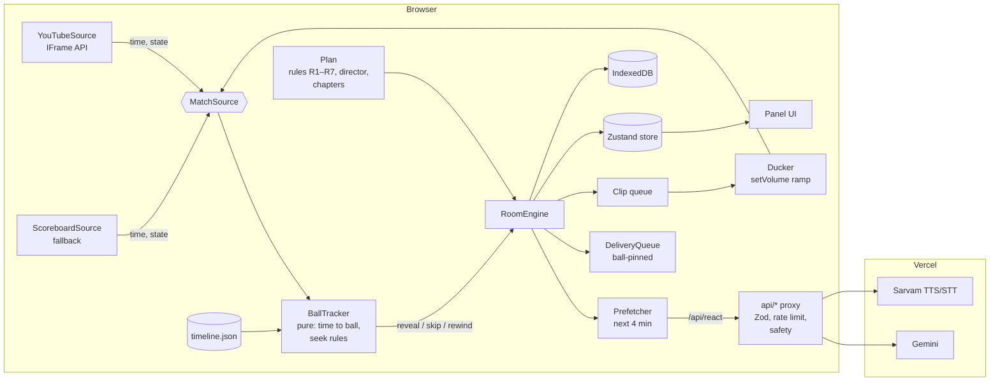

# Fun-Banter v1.2 — Redesign

Inputs: [AUDIT.md](AUDIT.md), spec §1.1, the owner's v1.2 change request.
Every decision below was made on the owner's behalf and is also recorded in `docs/decisions/` (ADR-0005 to ADR-0009).

## 1. Visual direction

| | A. Floodlit, refined | B. Scorecard paper | C. The commentary box *(chosen)* |
|---|---|---|---|
| Idea | Keep v1.1's floodlit navy and marigold, and tidy it. | Lord's printed scorecard: cream paper, serif, ink rules. | The panel is *our gang's own commentary box*: a ball rail down the left edge, voices hanging off the ball they were said on, and one big push-to-talk "mic". |
| Pro | Cheap. Already has an identity. | Strong sense of Lord's. | It shows the product truth ("synced to the ball, voice-first") in the layout itself. Glanceable: the current ball and who is talking are the two biggest things. |
| Con | Keeps the chat-app shape the audit criticised (H1, H2, H4). | Cream-and-serif is the most generic "tasteful AI" look. A light panel beside a busy TV picture glares. | More layout work. |

**Chosen: C, the commentary box.** It keeps the floodlit palette from A, because a dark panel recedes beside a bright
broadcast picture.

- **Colour:** `--ink-0 #0b1626` (panel), `--ink-1 #13233a`, `--ink-2 #1b3150`, `--chalk #f4f1e8`,
  `--chalk-2 #a9b9cc`, and `--marigold #ffc233` (the one action colour: the mic and the primary CTA).
  `--red #ff5a4f` is used only for wickets. The gang colours Dev `#ff8a3d`, Ritu `#f06bb5` and Sunny `#5cc8ff`
  are the only other hues.
- **Type:** Big Shoulders Display for numbers and headlines (scoreboard heritage) and Figtree for UI. The scale is
  12 / 14 / 16 / 20 / 28 / 44 / 72.
- **The one bold element:** the **wicket slab**. When a wicket falls at your ball, a red slab cuts across the rail and
  the panel edge flashes. Everything else stays quiet.
- **Rules:** nothing ever overlaps the video. One action colour. Structure (rail, ball chips) carries information,
  never decoration.

## 2. The reviewer journey (target)

| t | What they see and do |
|---|---|
| 0 s | **Start screen.** "Your gang's commentary, synced to the ball." A visible gang strip (Dev, Ritu, Sunny, "AI friends" chip), one CTA **"Watch with the gang"**, and an optional "Your hero" chip row (default Rohit). The disclosure is one line under the CTA. |
| 5 s | One tap. The room opens: the real ECB video on the left, our panel on the right. The video starts at **Chapter 1, "Topley strikes early"**, India 2.1 overs. Sunny's scene-setting line plays at once, so there is no dead air. |
| 10 s | The panel top bar shows *"Pinned to ball 2.1 · IND 4/0"*. A Gang Call row offers "Over 3: Wicket or Six?" and Dev and Ritu have already called it. |
| 30 s | Friends chat ball by ball, one line on most balls. The mic hint pulses once: "Hold Space to talk." |
| ~1:30 | **2.4: Rohit lbw b Topley.** The wicket slab fires. Rohit is *your* hero, so Dev and Ritu tease you and **one big line card** offers your comeback ("Say it, or tap to send"). At the end of over 3 the Gang Call resolves and the result shows in the panel. |
| ~2:00 | Sunny nudges: "Go grab chai, we'll call you." **Step away** → the panel goes into away mode, and the demo time-skips the video to over 11 (labelled honestly). The video is never covered. |
| ~2:20 | **Dev calls you back** with a ringing call card in the panel: "Get back here, Kohli's in trouble!" → Back → the catch-up card names Dhawan and Pant's wickets, and the missed clips are listed. |
| ~3:00 | 11.2: Kohli caught Buttler b Willey. Dev's hero is out: Dev laments, and you get a tease line card for Dev. |
| ~3:30 | "Jump to moment: **The six-for**" (or it auto-advances). 38.1–38.5: Chahal bowled, then Prasidh caught. **Topley 6/24.** |
| ~5:00 | **Wrap.** "Tonight's gang story" headline, roast of the night, the audio reel and the numbers. It is saved to the memory shelf, with Rewatch. |

## 3. Side-panel information architecture

```
┌──────────────────────────────┐
│ ● Pinned to ball 2.4  IND 4/1│  now bar: ball, score, step away
├──────────────────────────────┤
│ (You) (Dev) (Ritu) (Sunny)   │  gang row: speaking ring and live waveform
├──────────────────────────────┤
│ 2.3 │ Ritu  "Topley's on…"   │  ball rail + voice rows (one line each,
│ 2.4 │▌WICKET Rohit lbw 0 (7) │  wicket slab, tap a row to replay)
│     │ Dev   "Bro, your hero…"│
├──────────────────────────────┤
│ YOUR LINE · comeback to Dev  │  dock: one prompt at a time
│ "Talk to me after…"  [Send ↻]│  (line card / Gang Call / catch-up)
│ 😂  🔥  😭  🤡                │  reactions with bursts
│ [  HOLD SPACE TO TALK  ]     │  the mic, always in the same place
└──────────────────────────────┘
```

**Cut:** the typing box during play (C4). The "Gang commentary" title (the product name is in the app bar). Hero text
under avatars. The fake browser URL bar.

## 4. Target architecture



- **MatchSource** (`getCurrentTime, play, pause, seekTo, setVolume, getVolume, onStateChange`) is the only way the
  app touches the match. Both sources run on **the same timeline**, so the fallback replays the very same journey
  and chapters.
- **BallTracker** turns `time` into events:
  - `reveal(seq)`: normal play.
  - `skip(from, to)`: a forward seek of more than 2 balls. The items go to catch-up, not out as a burst.
  - `rewind(to)`: the playhead moves back, and nothing is re-delivered.
  - Buffering and ads count as paused.
- **No clock holds.** A real video can't wait for AI, so lines are prefetched about 4 minutes of video ahead.
  At reveal: use the live line if ready, else the precomputed line, else the template.

## 5. Keep / refactor / delete

| Keep | Refactor | Delete |
|---|---|---|
| Rules R1–R7, director (new intents `setup`, `chatter`), Gang Calls, stats, `DeliveryQueue`, IndexedDB, recorder, clip queue, all of `api/`, prompts, safety, bundle check | `RoomEngine`: time from the source and tracker, no holds or speed. `plan.ts`: drop pacing, add chapters and call-back points. `AudioEngine`: the ducker drives `MatchSource.setVolume`, and the crowd synth only runs for the scoreboard. `BroadcastView` becomes the ScoreboardSource view. All panel components (new design system). | `ReplayClock` and `pacing.ts` (replaced by timeline time). `BrowserChrome`. The `AwayLayer` overlay. The text composer during play. The IND v NZ data (archived in git history and spec Appendix B). |

## 6. Build plan (in order, one commit each)

| # | Step | Acceptance |
|---|---|---|
| 1 | **Match data.** Cricsheet 1276908 → `match.json`, player stories, data test | The test asserts ENG 246 all out (49), IND 146 all out (38.5), England won by 100 runs, Topley 9.5-24-6, and all 20 wickets |
| 2 | **Timeline core.** `timeline.json`, `src/core/timeline.ts` (lookup, interpolation), `BallTracker` (seek rules) | Unit tests: time → ball, interpolation, seek forward goes to catch-up, seek back doesn't re-deliver, buffering pauses |
| 3 | **Sources.** `MatchSource`, `YouTubeSource`, `ScoreboardSource`, ducker, fallback switch | Unit: the ducker restores volume. Integration: a player `onError` switches to the scoreboard |
| 4 | **Engine rewire.** The engine runs on the tracker; plan, chapters, call-backs, away time-skip | The existing unit tests pass. The journey runs headless on the scoreboard |
| 5 | **Design system and new UI.** Tokens, app shell, panel, start screen, wrap, shelf | No hard-coded colours or sizes in components. AA contrast. Nothing over the player |
| 6 | **Content.** Personas (all India fans), prompts and templates for the new match, precompute safety net | `docs/precomputed-review.md` regenerated. All chapter beats are covered |
| 7 | **`/dev/tag` tool** (dev only) | Space, Backspace, arrows and Export work. Absent from `dist/` (the bundle check verifies it) |
| 8 | **E2E.** Mocked YouTube journey, offline, embed error, mic denied, resume | All pass |
| 9 | **Proof.** Real browser walk with the real embed, `/security-review`, spec v1.2, RESULT.md | Screenshots and an observations log |
